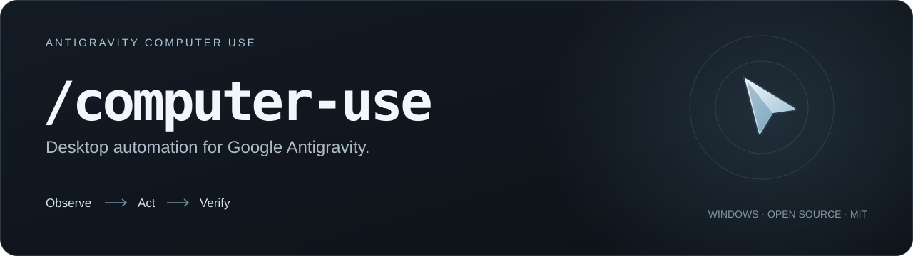
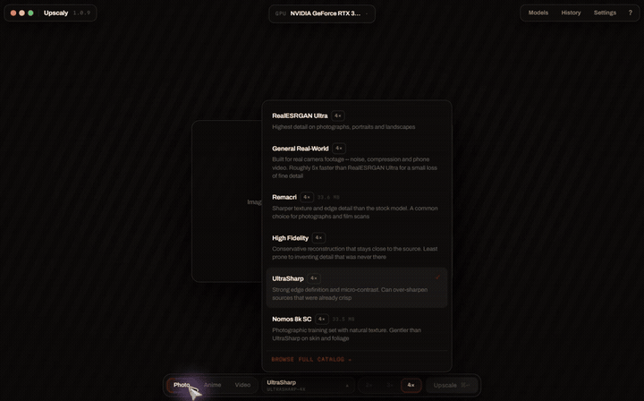

<p align="center">
  
</p>

<h1 align="center">Antigravity Computer Use</h1>

<p align="center">
  Give Google Antigravity real Windows desktop control with <b>/computer-use</b>.<br>
  Screenshots, accessible controls, your real cursor, and a clear way to take control back.
</p>

<p align="center">
  <a href="https://github.com/shayann07/antigravity-computer-use/actions/workflows/windows.yml"></a>
  <a href="https://github.com/shayann07/antigravity-computer-use/releases"></a>
  <a href="LICENSE"></a>
  
</p>

<p align="center">
  <b><a href="https://github.com/shayann07/antigravity-computer-use/releases/tag/v0.3.0-beta.2">Download for Windows</a></b> ·
  <a href="#see-it-in-action">Demo</a> ·
  <a href="#install">Install</a> ·
  <a href="docs/INSTALLATION.md">Documentation</a> ·
  <a href="HANDOFF.md">Roadmap &amp; handoff</a>
</p>

Antigravity is the agent. This open-source skill gives its existing model native
desktop tools: inspect applications, use buttons and fields, navigate native file
dialogs, and operate custom canvases through screenshots. It works in the
**Antigravity Agent Manager App**. No separate LLM, extra model subscription,
browser extension or required MCP server.

> **Windows beta.** The current release is **v0.3.0-beta.2**. Real desktop tasks
> have passed, but overall orchestration speed and wider reliability qualification
> remain unfinished. See [what is verified](#status-and-limits) before installing.

**macOS development:** an experimental Apple Silicon/Intel adapter shares the
same controller, tool schemas and `/computer-use` skill. It is undergoing native
CI and installation checks; actual Mac desktop acceptance is still pending.
[Mac candidate and qualification details](docs/MACOS.md).

The unreleased beta.3 work in [PR #1](https://github.com/shayann07/antigravity-computer-use/pull/1)
adds control recovery, sanitized failure reports and signed whole-bundle updates.
It shares the runtime with the Mac adapter. [Implementation and acceptance status](docs/RELIABILITY-IMPLEMENTATION.md).
The Windows download and one-line installer below remain pinned to beta.2.

## See it in action

<p align="center">
  
</p>

<p align="center"><a href="docs/media/upscaly-demo.mp4"><b>Watch the full 39-second real demo</b></a> · <a href="docs/media/UPSCALY-DEMO.md">Recording details</a></p>

An actual Antigravity task operating **Upscaly 1.0.9**, with a different
user-provided portrait, our breathing edge glow, working bar and moving native
cursor. The **39-second excerpt plays at normal speed**; waiting and the private
file picker are cut. The native NCNN process was observed and the resulting
2800×4496 PNG independently decoded. This records a development build with the
new local recording preference; the downloadable beta.2 predates that preference.
The excerpt is not a task-speed benchmark. [Recording provenance](docs/media/UPSCALY-DEMO.md).

<details>
<summary><b>Minimal desktop controls</b></summary>

<p align="center">
  
  
</p>

The bar, breathing edge glow and temporary custom cursor indicate active control.
These two images are **production-renderer previews**, not live desktop captures.
Passive background startup stays hidden. End hides the controls; stopped controls
auto-dismiss after eight seconds. [Interface and media notes](docs/media/README.md).

</details>

## What it can do

| Capability | How it works |
| --- | --- |
| **Observe the actual app** | Screenshots plus Windows accessibility names, roles and values. |
| **Use native controls** | Click, invoke, select, toggle and set values through observed accessibility references. |
| **Operate visually** | Move the real cursor, click, double-click, right-click, drag and scroll using screenshot coordinates. |
| **Enter text and shortcuts** | Native keyboard input, Unicode text and explicit clipboard-preserving paste. |
| **Work across apps** | Discover, launch, focus and select windows, including approved owned dialogs and file pickers. |
| **Verify each step** | Fresh observations, bounded sequential batches and no automatic replay after uncertain input. |
| **Give control back** | Pause, optional human takeover, independent Stop and input cleanup. |

Useful tasks include checking a development build's UI, importing an image,
changing export settings and verifying the output. Describe the result you want:

```text
/computer-use
Open my app, import the sample image, export it as PNG, and verify the result.
Restore the original settings and end computer use when finished.
```

## Install

On Windows, paste this one line into PowerShell:

```powershell
irm https://raw.githubusercontent.com/shayann07/antigravity-computer-use/main/install.ps1 | iex
```

Then open Antigravity, choose **/computer-use**, and describe your task. The
installer downloads and verifies the pinned Windows beta, installs the global
skill and enables its passive background service. It preserves existing settings
and emergency Stop. Requires Windows x64 and the standard .NET Framework runtime.

For manual download, project-local setup, permissions, updates and rollback, see
[installation options](docs/INSTALLATION.md). Fresh-install native ACL qualification
remains open where project ancestors are replaceable; see [validation](VALIDATION.md).

## Permissions and human control

- **Standalone approval is the default.** Approve an application per session and
  confirm sensitive operations separately. Grants bind to its actual process identity.
- **Host-managed approval is an explicit installation option.** Use
  `--permission-mode host-managed` to rely on Antigravity's execution review. It
  does not inspect or authenticate the Turbo preset. See [permission policy](docs/INSTALLATION.md#permission-policy).
- **Keep working is the default.** Incidental mouse or keyboard activity does not
  pause automation. Optional **Yield on input** pauses on deliberate human activity.
- **Esc, Ctrl+Alt+F12 or Stop** invalidates control and releases automation-held
  input. Emergency re-arm is human-only. Ordinary completion uses `end`.

Use one active desktop task at a time. Windows virtual desktops share the physical
mouse and keyboard. Authentication, security surfaces, UAC and the secure desktop
require human handoff. Screenshots go to Antigravity's selected model/provider;
this project adds no separate model service or telemetry. [Security model](SECURITY.md).

## Status and limits

| Area | Verified evidence and remaining work |
| --- | --- |
| **Published beta.2 source snapshot** | 139 passed, zero failed, five explicit installation-ACL skips. For the changing development candidate, inspect PR #1 and its implementation log. Skips are not qualification passes. |
| **Beta.2 lifecycle** | Actual native checks cover hidden startup, explicit controls, End, capture cleanup, stopped-state refusal and automatic dismissal. Automatic Antigravity-managed startup and read-only native discovery also passed on the installed beta.2 build. |
| **Real app workflow** | Earlier beta.1 controller/helper completed actual Antigravity-driven Upscaly AI PNG/JPEG exports with independent output, database and native-engine verification. Full AI acceptance has not been repeated on the changed beta.2 helper. |
| **Speed** | The earlier High-effort Antigravity tasks took **4m29s PNG / 4m33s JPEG**. Host/model orchestration dominates the remaining delay. These are historical witnesses, not a current speed guarantee. |
| **Still open** | Live physical queued/held-input interruption on the final helper, real mixed-DPI/multi-monitor hardware, broader applications and cursor/glow feedback. |
| **Platforms** | Windows first. macOS/Linux are not qualified release targets. Development binaries are unsigned. |

[Current handoff and TODOs](HANDOFF.md) · [Validation](VALIDATION.md) ·
[Performance measurements](docs/PERFORMANCE.md) · [Project status](PROJECT-STATUS.md)

## Build and contribute

Windows source builds require **Windows x64, Node 24.20.0** and the inbox .NET
Framework compiler. Experimental Mac builds use **macOS 14+, matching Intel or
Apple Silicon Node 24.20.0, and Xcode Command Line Tools**; follow the
[Mac build and qualification guide](docs/MACOS.md). There are no npm runtime
dependencies. Clone the current implementation branch/PR for Mac development;
the published Windows tag does not contain the Mac adapter.

```powershell
git clone https://github.com/shayann07/antigravity-computer-use.git
cd antigravity-computer-use
npm test
node scripts/check-provenance.mjs
npm run bundle
```

The portable bundle is written to `dist/AntigravityComputerUse-windows-x64`.
Interactive native tests require an available desktop; do not run them while
another person or session owns it. Keep temporary evidence under ignored `.localdata/`.

Contributions that reduce measured orchestration latency or improve real-app
reliability are especially useful. For bug reports, include your Windows version,
display scaling, app/version, expected result and the failed step. Remove private
data before sharing evidence.

[Contributing](CONTRIBUTING.md) · [Review guide](docs/review-guide.md) ·
[Claude Code continuation brief](docs/CLAUDE-CODE-HANDOFF-PROMPT.md) ·
[Branch policy](docs/BRANCHES.md) · [Report a bug](https://github.com/shayann07/antigravity-computer-use/issues/new)

## Open source and attribution

**MIT licensed.** Built on the published MIT native implementation from
[ridelink0/claude-computer-use](https://github.com/ridelink0/claude-computer-use),
with attributed adaptations from OpenAI's MIT computer-use sample and Anthropic's
MIT quickstarts. Exact revisions, modifications and hashes are recorded in
[UPSTREAM.json](UPSTREAM.json); the original licenses are retained in
[third-party notices](THIRD_PARTY_NOTICES.md).

This is an independent project, not an official Google, OpenAI or Anthropic product.

[License](LICENSE) · [Security](SECURITY.md) · [Implementation history](IMPLEMENTATION_PROGRESS.md)
