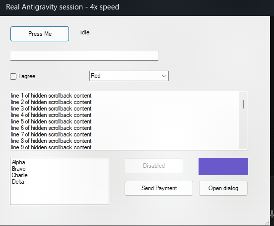
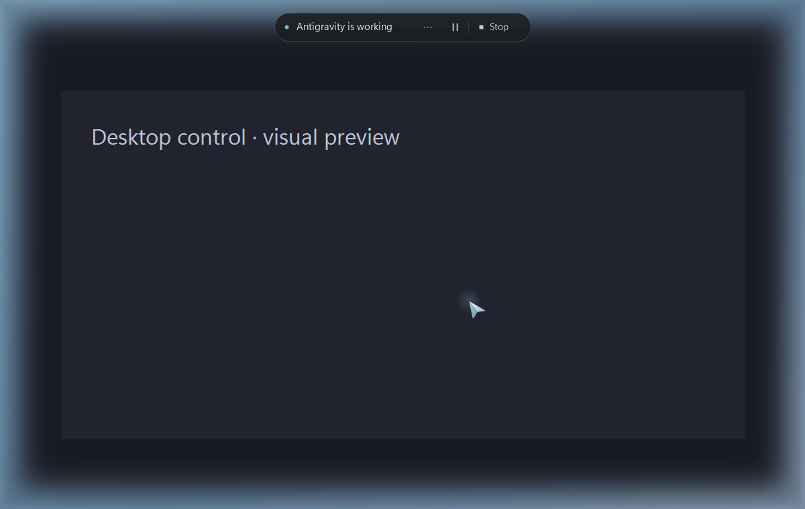

# Antigravity Computer Use

**Windows beta candidate 0.3.0-beta.1 is under qualification, not published yet.** Direct native integration has real-app witnesses, but the latest Agent Manager acceptance run exposed excessive orchestration latency and was cancelled. Speed changes are being tested before release; see the [validation boundary](VALIDATION.md). The historical published v0.2.0 uses the older MCP integration.

[](https://github.com/shayann07/antigravity-computer-use/actions/workflows/windows.yml)

A `/computer-use` skill for **Antigravity Agent Manager**, using its existing model and native Windows desktop input. The current source uses **skill scripts and a persistent local native service, without MCP**. No separate model, API credentials, browser extension or agent framework.

The agent observes screenshots and accessibility controls, acts, then verifies the result. It can move the real cursor smoothly, click, type Unicode, use shortcuts, scroll, drag and operate owned dialogs. A compact control bar and breathing screen-edge glow indicate active control. The native helper restores temporary cursor styling and releases automation-held inputs when control ends.

## Install

The new direct Windows bundle is still a draft; it is not available for public download yet. When qualified, the complete portable bundle and SHA256 checksums will appear on the [releases page](https://github.com/shayann07/antigravity-computer-use/releases). Normal bundle installation needs neither a compiler nor Python. The older published v0.2.0 does not include this rework.

To build from source instead, use Windows x64, Node 24.20.0 and the Windows .NET Framework compiler:

```text
npm test
npm run bundle
```

The source-build output is `dist/AntigravityComputerUse-windows-x64`. It includes Node and a prebuilt native helper.

Extract the complete bundle and run:

```powershell
.\install.cmd --integration direct --sidecar
```

This installs the global skill at `~/.gemini/config/skills/computer-use`, pins it to the bundled runtime, and removes only this project's previous MCP entry. Existing unrelated configuration is preserved and backed up. The private-storage candidate defaults to a per-user `D:\AntigravityComputerUse-<owner-hash>` directory when available, otherwise LocalAppData. It rejects shared writable ancestors and never changes their permissions. `--target <private-path>` changes it; `--workspace <path>` installs project-local instructions. Final installation qualification is still pending.

For App-managed background startup, the global direct installer supports opt-in `--sidecar`; its own configuration entry is backed up and unrelated permissions/models are preserved. This uses [documented Antigravity Sidecars](https://www.antigravity.google/docs/sidecars/), with no MCP. Actual App-managed startup and its Restart control have been exercised without restarting Antigravity.

Start a fresh Antigravity conversation and invoke `/computer-use`. [Official App skills support scripts and slash invocation](https://antigravity.google/docs/skills). This is a supported skill executing local helpers, not an undocumented built-in desktop-tool hook. Fresh No Project conversations in Agent Manager have exercised the registered global skill, actual screenshot viewing and native actions. Other host versions still need their own check.

[Detailed installation, updates, rollback and removal](docs/INSTALLATION.md). Legacy MCP is an optional compatibility adapter (`--integration mcp`), not a dependency of the direct route. [Historical v0.2.0 release](https://github.com/shayann07/antigravity-computer-use/releases/tag/v0.2.0).

## Permissions and control

Standalone mode is the default for direct installs. The native runtime asks the human for app/session approval and confirms sensitive effects separately. Grants bind to executable, process ID and creation time; model-supplied approval/permit flags are rejected.

An operator can explicitly install `--permission-mode host-managed` to rely on the host's terminal execution permissions instead of duplicate native dialogs. **The runtime cannot inspect or prove Antigravity's Turbo preset.** In this mode the agent must obtain any sensitive-action approval required by the host/user before executing the command. Broad terminal allow rules grant broad desktop authority. The installer does not change host security settings or create blanket allow rules.

- **Keep working** is the default: ordinary physical mouse/keyboard activity does not pause automation. Pause deliberately with the control bar. One physical desktop still has one cursor; this is not independent background desktop control.
- **Yield on input** is optional: deliberate human input pauses. The skill preserves its task instead of opening a question form just because control paused. In host-managed mode, an explicit new user message authorizes soft `resume`; a fresh observation is required and old input is not replayed.
- **Esc / Ctrl+Alt+F12 / Stop** cancels independently, invalidates work and releases automation-held inputs. Chat Resume cannot clear emergency Stop; local human re-arm is required. Never restart a service to bypass the latch.
- End ordinary tasks with `end`. Another session can start without restarting Antigravity.

Native identity, geometry, observation, budget and watchdog checks remain active in both permission modes. They are not an OS sandbox against software running under the same Windows account. Pixel semantics cannot be classified perfectly. Authentication, security surfaces, UAC and secure desktop remain human handoffs. See [SECURITY.md](SECURITY.md).

## Direct command workflow

The installer creates a short `cu.mjs` entrypoint with bundled `cu-node.exe`, pinned to the exact installed release, and puts that command in the skill. Arguments reach Node directly without a command-shell forwarding wrapper. The development entry is:

```text
node scripts/desktop.mjs --help
node scripts/desktop.mjs serve
node scripts/desktop.mjs apps
node scripts/desktop.mjs snapshot --hwnd 123
node scripts/desktop.mjs click --hwnd 123 --observation-id FRAME --index 7 --risk routine --reason "Open settings"
node scripts/desktop.mjs end
```

Windows Agent Manager terminal jobs were observed on an isolated `exebox` desktop, even with Turbo selected. Start the installed **Start Computer Use.cmd** from the normal Windows desktop first; the skill connects to that pinned local controller through private IPC. No MCP or separate model is involved. Starting it inside the isolated terminal does not supply visible-desktop access. The native preflight refuses a different/unavailable input desktop; it never switches desktops or relaxes host security. On hosts that genuinely share the input desktop, `serve` supports a host-owned background task (`IsDaemon:true`, `WaitMsBeforeAsync:1000`). A normal external terminal can use `start`.

A snapshot returns an indexed accessibility tree and a local `image.path`. **Open the actual image in the host viewer** (`read_file` in the tested Agent Manager App). Subsequent actions need the fresh, one-use `observation_id`. Coordinates are returned-image pixels, mapped centrally to physical pixels. Prefer accessible controls; use screenshot coordinates for custom canvases. Named action flags return a fresh tree without an image by default; add `--image` at visual checkpoints. `--settle-ms` delays observation by at most 2seconds without repeating input. Fetch unfamiliar schemas together with `describe click drag scroll`; avoid a catalogue interrogation loop. Legacy JSON/UTF-8 request files remain supported; `--text-file` avoids shell interpolation for bulk text.

The service writes bounded timing/outcome receipts automatically, without request text, clipboard contents, raw UI trees or credentials. The agent need not create result files or copy screenshots for logging. `launch --observe` can return the exact launched process's first unambiguous window. Small named `run --step` batches validate all steps before input, take fresh observations between steps, capture the final image and stop on failure. The visible-desktop companion completed an actual Agent Manager Upscaly AI PNG workflow in roughly five minutes. Native calls were mostly under one second; host/model gaps still dominate. App-managed sidecar startup/restart and an actual skill task now have witnesses; further speed qualification remains open. See [performance work](docs/PERFORMANCE.md).

Available commands include `apps`, `snapshot`, `move`, `click`, `type`, `set_value`, `key`, `scroll`, `drag`, `focus`, `file_dialog`, `launch`, `open`, `clipboard`, `run`, `wait`, `pause`, `resume`, `stop`, `status`, `end`, `shutdown`. Use `apps` with `include_hidden:true` to find minimized/other-desktop windows. Focus the intended window before requesting its pixels; never confuse it with a closed app or act on the wrong visible desktop.

The service authenticates local clients with a random per-session capability, rejects overlapping actions, prioritizes Stop, and cancels an active operation if its client disconnects. Screenshots are private local data, capped at50 recent files. There is no telemetry or separate model connection; host/provider retention still applies.

Native `type` is paced and bounded to 400 UTF-16 units. For larger text, explicit `paste` temporarily uses the clipboard and restores supported formats; it refuses unpreservable formats and avoids overwriting a new human copy. Both require normal permission review. Verify the result; completed input does not prove exact content.

## Evidence and limits

The rework has been used directly in real original/feature Upscaly builds: file pickers, semantic and coordinate actions, real wheel scrolling, split-divider drag, virtual-desktop recovery and100% RealESRGAN Ultra AI PNG export. Independent decoded-file checks and engine diagnostics distinguish that result from ordinary resizing. Backend hardware tests also exercise real AI PNG/JPEG. These are specific witnesses, not qualification of every workflow or model.

A second session is testing the same controller in a real rich-text editor/emulator and reporting controller defects separately from editor defects. Real GUI JPEG/PNG reruns, in-flight AI cancellation, execution-profile selection and actual output headers have witnesses. Antigravity itself completed an Ultra 4x AI export, deliberate soft pause/resume and a second session without restarting. A separate installed dev7 check interrupted a held drag, skipped all seven queued actions, and preserved Stop across service replacement; the owner then performed physical Esc and both local re-arms. Its final cleanup argument error and separate recovery remain recorded rather than being presented as a clean script pass.

The final dev7 peer-editor run also exercised Copy after Open/New, rich transfer with an image, Undo/Redo, rotation, larger-font control access and real keyboard emoji input. The emulator's clipboard-sharing bridge reduced content to plain text when enabled; disabling it allowed rich transfer. The original setting was restored. One expired observation was correctly refused; two completed Close actions reported the expected missing-window verification result. No new controller defect was found in this bounded run.

The named-batch candidate passed116 local checks and GitHub source CI. New direct ownership/failure checks bring the next source candidate to123 local passes; its final package qualification is pending. A separate native fault-provider test reproduced unwanted fallback clicks after provider exceptions and passes the repaired candidate without those retries. That fault test does not replace actual application or Agent Manager acceptance. Exact build identities, evidence boundaries and remaining work are in [PROJECT-STATUS.md](PROJECT-STATUS.md), [VALIDATION.md](VALIDATION.md) and [IMPLEMENTATION_PROGRESS.md](IMPLEMENTATION_PROGRESS.md). Broader failure recovery, mixed-DPI/multiple-monitor hardware and owner visual acceptance remain open. macOS/Linux are not release targets yet; platform-specific code remains separate.

## Historical recording and interface



[Real-time excerpt](docs/media/real-demo-realtime.mp4) · [4x MP4](docs/media/real-demo-4x.mp4) · [Recording details](docs/media/REAL-DEMO.md). This is an actual older Antigravity task in a disposable app, not the current Upscaly comparison or the new direct integration.




This image is a renderer preview, not an autonomous task or evidence of the latest live appearance. The real desktop has compact Pause/Stop controls, a click-through edge glow and temporary cursor styling. Cursor travel eases to its exact endpoint; reduced motion is respected. [Visual design](docs/visual-design.md).

## Develop and contribute

`npm test` runs bounded automated/component checks. `node tests/bundle-identity.mjs` checks repeated packaging without rebuilding unchanged native sources. Native integration scripts operate disposable windows and must not run while someone else controls the desktop. Actual application and human-input checks remain distinct from fixtures and simulations. See [the review guide](docs/review-guide.md).

This reuses the published MIT native implementation from `ridelink0/claude-computer-use`, with attributed OpenAI recovery and Anthropic sizing/batching adaptations. Exact revisions and modifications are in [UPSTREAM.json](UPSTREAM.json) and [THIRD_PARTY_NOTICES.md](THIRD_PARTY_NOTICES.md). No private vendor implementation is included. MIT licensed, unsigned development binaries. Independent of Google, OpenAI and Anthropic.

[CONTRIBUTING.md](CONTRIBUTING.md) · [LICENSE](LICENSE)
